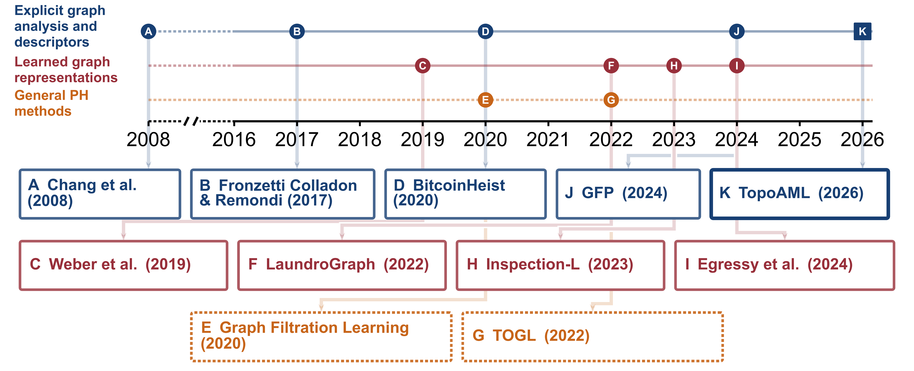
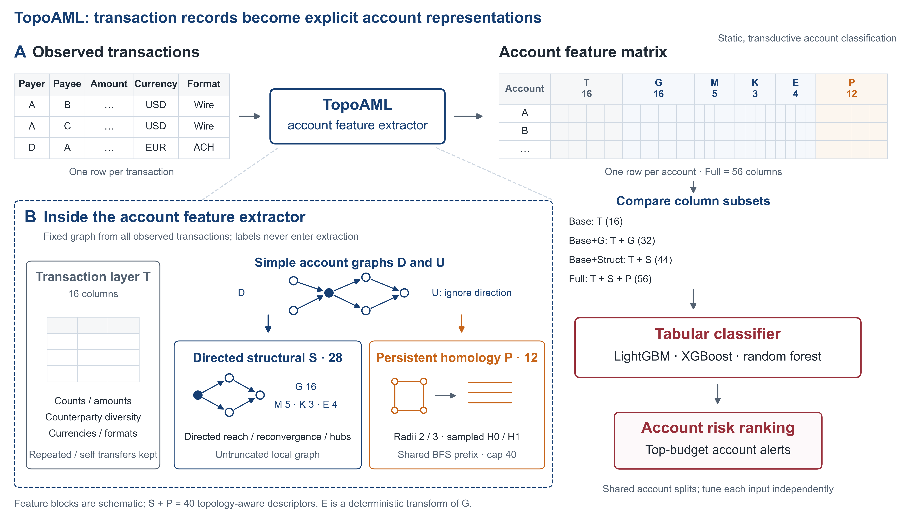

# TopoAML reproducibility materials

Code and compact results for **Topology-Aware Graph Descriptors for Imbalanced
Classification in Anti-Money Laundering** (manuscript snapshot: 2026-11-07).
 **TopoAML** is the account representation evaluated
in this manuscript. This package concerns IBM AML **HI-Small and LI-Small**. It
does not describe the project's earlier Elliptic, PaySim or XBlock experiments.

The package includes the current additions to Table C.1 (six Base+G rows), Table
5B (N/Q controls), and Table C.7 (all three GFP classifiers).

## Study design

### Research context and positioning



**Figure 1. Research milestones and positioning of TopoAML.** Representative
milestones distinguish explicit graph analysis and descriptors, learned graph
representations, and general persistent-homology methods. Letter K denotes this
study, which evaluates the incremental value and redundancy of account-level
descriptors. [View vector PDF](paper/figures/fig01_research_milestones.pdf).

### TopoAML framework and paired evaluation



**Figure 2. From transaction records to account representations and risk ranking.**
TopoAML combines 16 transaction aggregates (T), 28 directed structural descriptors
(S), and 12 persistent-homology summaries (P). Four nested inputs—Base (16),
Base+G (32), Base+Struct (44), and Full (56)—are compared within each tree learner
using shared account splits and independent tuning. Scores rank accounts for
alerts at a fixed review budget.

The evaluation is static and transductive: the graph includes all observed
accounts, while labels are excluded from descriptor extraction and test labels
are excluded from model fitting and selection.
[View vector PDF](paper/figures/fig02_topoaml_framework.pdf).

## Quick start: audit and reconstruct saved summaries

Only Python 3.10+ and its standard library are needed for this command:

```bash
python3 tools/audit_results.py --out reproduced_results
```

Choose an output directory that does not already exist. The command checks the
file manifest, parses research Python sources, reaggregates saved fold metrics,
checks all 46 reported method/input settings and their 25 folds, and reconstructs
the 138 fixed-budget summaries from 3,450 fold/budget records. It checks the
current table inventory and writes CSV summaries plus an `audit.json` report.
It does not train models, read raw transactions, use a network or load models.

Passing this audit demonstrates consistency of the packaged saved results. It
does not independently regenerate prediction scores or verify model fitting.

## Contents

```text
Altman_experiments/code/       Research feature, training, analysis and verifier code
Altman_experiments/results/    Accepted fold/seed/paired metrics and protocols
results/timing/               Recorded CPU/CUDA/GFP timing summaries and fold records
paper/tables/                 All 22 current table fragments, including new additions
paper/figures/                Figures 1–2 and the inline Figure 3 TikZ source
paper/figure_sources/         Sources for the two schematic figures
data/dataset_statistics/      Aggregate public-dataset counts, no raw account data
tools/audit_results.py        Portable saved-result reaggregation
docs/ANALYSIS_MAP.md          Paper table → code → result mapping
docs/REPRODUCTION.md          Heavy analysis workflow and omitted-input boundaries
environment/                 Recorded CPU, CUDA and GFP environment information
provenance/                   Original and packaged source checksums
MANIFEST.json                Packaged-file size and SHA-256 inventory
SHA256SUMS                   Standard checksum list
```

The dated result and script names retain the experiment provenance. They are not
different paper versions to be pooled. The mapping document identifies the
accepted source for each analysis.

## Data and full analysis

Raw IBM synthetic transactions and laundering-pattern annotations must be
obtained separately from the dataset's original distribution. Large feature
caches, split arrays, saved prediction vectors and trained models are omitted.
No third-party wheel, virtual environment, CUDA runtime or font file is bundled.
See [data/README.md](data/README.md) and
[docs/REPRODUCTION.md](docs/REPRODUCTION.md) before running a training script.

The research scripts are the actual implementations used in the study, with a
small set of documented path-portability changes. Many intentionally require
registered source hashes and complete input packages. Merely installing Python
packages does not recreate those omitted assets. The lightweight audit above is
ready to run; a complete raw-data-to-model rerun has **not** been performed as
part of packaging.

## Interpreting results

- AP is the primary ranking metric; threshold-based F1 and fixed alert budgets
  address different operating points.
- Means and sample SDs use 25 dependent outer folds. Direction counts are
  descriptive, not independent statistical replications.
- Graph descriptors use a static whole-period graph. The data are synthetic and
  were used during method development; this is not a chronological deployment
  test.
- GFP uses information from the transaction stream beyond the static graph;
  GraphSAGE uses a GPU. Input dimensions and recorded times alone do not establish
  a common-hardware or end-to-end efficiency ranking.
- The random-forest SHAP analysis was not complete in the manuscript snapshot
  and is excluded from this release's reported SHAP results.

## Repository, citation and licensing

The repository for these materials is
[Topology-Aware-Graph-Descriptors-for-Imbalanced-Classification-in-Anti-Money-Laundering](https://github.com/Janeyaoo/Topology-Aware-Graph-Descriptors-for-Imbalanced-Classification-in-Anti-Money-Laundering).
This research package accompanies the manuscript snapshot described above.
Repository metadata is recorded in `provenance/repository.json`. The coordinating
delivery audit, stored outside this package, records the actual upload receipt
and commit identifier. No commit identifier is embedded here, avoiding a
self-referential package hash. A release tag or DOI has not been assigned.

No new repository-wide license is assigned here. See
[LICENSE_STATUS.md](LICENSE_STATUS.md) for the current status. Cite the manuscript
title above and the final release identifier when available.

The source inventory records the manuscript SHA-256 and each copied file's
original and packaged hashes. Where a path was made portable or transport
metadata redacted, the inventory marks `adapted: true`. Historical acceptance
hashes refer to the original experiment files; `MANIFEST.json` binds this public
package. They should not be confused with one another.
